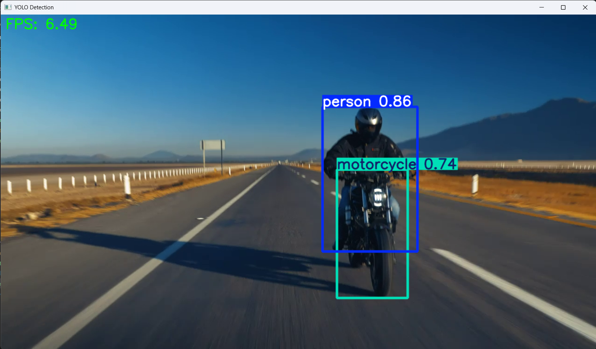

# Object Detection & Tracking with OpenCV

A comparative computer-vision project exploring learned detection, classical tracking, and custom tracking pipelines on person and vehicle videos. It combines detector baselines with motion, optical-flow, and appearance information.

**Contributor:** [Amirali Yazdiani](https://github.com/amirali83) · **Type:** Group course project. The original group report and its attribution are preserved.

**[Read the project report](<Project Report.pdf>)** · **[Browse recorded results](Results/)** · **[View input clips](files/)**



## Methods and entry points

| Method | Implementation |
| --- | --- |
| YOLO detection | [YoloCode.py](Codes/Detection/YoloCode.py) |
| Faster R-CNN detection | [FasterRCNN.py](Codes/Detection/FasterRCNN.py) |
| KCF / MOSSE / CSRT tracking | [Classical tracker scripts](Codes/Tracking/) |
| Shi–Tomasi + Lucas–Kanade + Kalman | [optical_flow_kalman.py](Codes/Ours/optical_flow_kalman.py) |
| Multi-object association | [multi_object_tracking.py](Codes/Ours/multi_object_tracking.py) |
| Appearance-assisted tracking | [appearance_tracking.py](Codes/Ours/appearance_tracking.py) |

## Run an example

Use **Python 3.10+**, a desktop display, and compatible PyTorch/torchvision packages. Use `opencv-contrib-python` to obtain the classical tracker implementations; avoid installing multiple OpenCV wheel variants in the same environment.

```bash
python -m venv .venv
# Activate .venv using your shell's activation command.
python -m pip install -r requirements.txt
python Codes/Detection/YoloCode.py
# Or:
python Codes/Ours/optical_flow_kalman.py
```

Run from the **repository root**: scripts resolve clips in `files/` and model weights relative to the working directory. Select the clip in each script's `video_path`, `video_source`, or `source` setting. Several YOLO weights are supplied; torchvision model weights may download on first use. Detection/tracking windows require a desktop session. Use the on-screen quit key or Escape for the relevant script.

## Results and interpretation

The `Results/` directory contains recorded videos and FPS screenshots for the submitted experiments. The report provides the comparison context. FPS depends on the machine, model, clip, and measurement method, so the saved examples are not hardware-independent benchmark scores.

## Repository guide

| Path | Contents |
| --- | --- |
| `Codes/Detection/` | Detector baselines |
| `Codes/Tracking/` | Classical tracker integrations |
| `Codes/Ours/` | Custom tracking variants |
| `files/` | Input videos and original specification |
| `Results/` | Recorded outputs and performance screenshots |
| `latex/` | Report source and figures |

YOLO, torchvision detectors, and OpenCV trackers are upstream components. The project contribution is their evaluation and integration with the custom tracking pipelines; pretrained models are not claimed as original models.

[Explore my other projects →](https://github.com/amirali83?tab=repositories)
